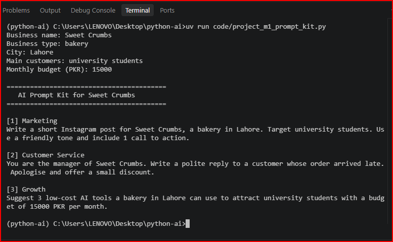

# Python for AI

Student: Sonia Nazir
Course: Python for AI

## My Goal
I want to become an AI Agent Developer and create useful AI solutions for businesses.

## About This Project
This project contains my Python practice work. I am learning Python basics and how Python is used in Generative AI and Agentic AI.

## How to Run
To run the main file, use this command:

uv run main.py

## Lessons Completed
- Lesson 1.1: AI Career Intro
- Lesson 1.2: Toolkit Proof
- Lesson 1.3: Client-Ready Repo
- Lesson 1.4: Business Prompt Builder

## Module 1 Project: AI Prompt Kit

A Python tool that turns a local business's details into three ready-to-use
AI prompts for marketing, customer service and business growth.

**Run:** `uv run code/project_m1_prompt_kit.py`



**Who would pay for this:** Small business owners who want to use AI but
do not know how to write effective prompts.

## Lesson 1.8: Rule-Based Chatbot

### Project Description

This project is a rule-based chatbot for Sweet Crumbs Bakery.
It answers common questions about opening hours, prices,
location and ordering. It also handles complaints and
shows an AI prompt when it cannot answer a question.

### Intent Design Table

| Intent | Keywords | Bot Response |
|---|---|---|
| Complaint | refund, complaint, late | Refers the customer to a manager |
| Opening hours | hour, open, time | Shows opening hours |
| Prices | price, cost, how much | Displays cake and cupcake prices |
| Location | where, location, address | Provides example address |
| Ordering | order, delivery | Gives ordering guidance |
| Greeting | hi, hello, salam | Greets the customer |
| Exit | bye, exit | Ends the chat and displays a summary |
| Unknown question | No matching keyword | Displays an AI prompt |

### Python Concepts Used

- Variables and data types
- Input and output
- String methods: strip() and lower()
- If, elif and else
- While loop and break
- Counters and f-strings

### How to Run

```bash
uv run code/lesson_08_mini_chatbot.p