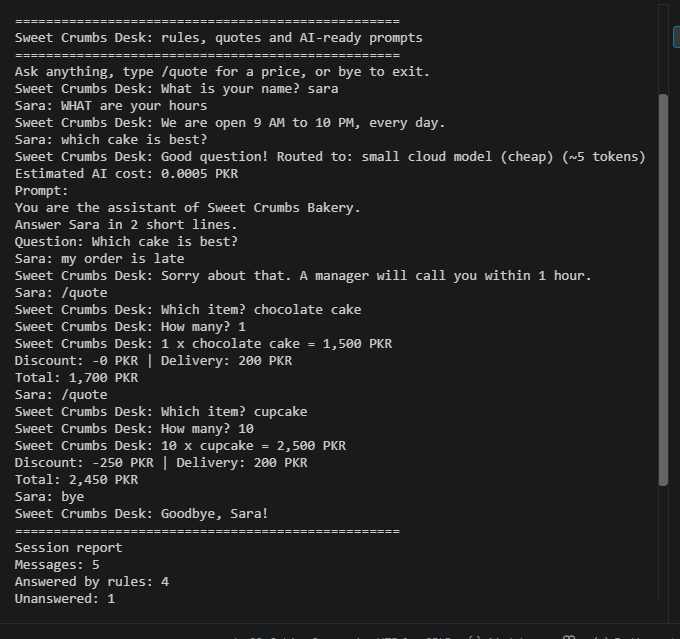

# Python for AI

Student: Sonia Nazir
Course: Python for AI

## My Goal
I want to become an AI Agent Developer and create useful AI solutions for businesses.

## About This Project
This project contains my Python practice work. I am learning Python basics and how Python is used in Generative AI and Agentic AI.

## How to Run
To run the main file, use this command:

uv run main.py

## Lessons Completed
- Lesson 1.1: AI Career Intro
- Lesson 1.2: Toolkit Proof
- Lesson 1.3: Client-Ready Repo
- Lesson 1.4: Business Prompt Builder

## Module 1 Project: AI Prompt Kit

A Python tool that turns a local business's details into three ready-to-use
AI prompts for marketing, customer service and business growth.

**Run:** `uv run code/project_m1_prompt_kit.py`


**Who would pay for this:** Small business owners who want to use AI but
do not know how to write effective prompts.

## Lesson 1.8: Rule-Based Chatbot

### Project Description

This project is a rule-based chatbot for Sweet Crumbs Bakery.
It answers common questions about opening hours, prices,
location and ordering. It also handles complaints and
shows an AI prompt when it cannot answer a question.

### Intent Design Table

| Intent | Keywords | Bot Response |
|---|---|---|
| Complaint | refund, complaint, late | Refers the customer to a manager |
| Opening hours | hour, open, time | Shows opening hours |
| Prices | price, cost, how much | Displays cake and cupcake prices |
| Location | where, location, address | Provides example address |
| Ordering | order, delivery | Gives ordering guidance |
| Greeting | hi, hello, salam | Greets the customer |
| Exit | bye, exit | Ends the chat and displays a summary |
| Unknown question | No matching keyword | Displays an AI prompt |

### Python Concepts Used

- Variables and data types
- Input and output
- String methods: strip() and lower()
- If, elif and else
- While loop and break
- Counters and f-strings

### How to Run

```bash
uv run code/lesson_08_mini_chatbot.py

## Lesson 1.8: Business Helper Bot

### Intent Design Table

| User Intent             | Keywords                              | Reply                                         |
| ----------------------- | ------------------------------------- | --------------------------------------------- |
| Complaint or human help | complaint, refund, late, human, agent | Apologize and connect the customer to a human |
| Opening hours           | hour, timing, open                    | Show the opening hours                        |
| Prices                  | price, cost, how much, fee            | Display example product prices                |
| Location                | where, location, address              | Provide the example business address          |
| Ordering                | order, delivery                       | Explain how to place an order                 |
| Greeting                | hi, hello, salam                      | Greet the user by name                        |
| Exit                    | bye, exit                             | Say goodbye and show the chat summary         |
| Other questions         | No matching keyword                   | Display an AI prompt for a future response    |

### Project Description

This project is a rule-based chatbot for Sweet Crumbs Bakery. It answers common questions about opening hours, prices, location, and ordering. It also identifies complaints, counts unanswered questions, and displays an example prompt for an AI model.

### Python Concepts Used

* Variables and strings
* Input and output
* String methods
* Conditional statements
* `while` loop and `break`
* Counters
* F-strings

### How to Run

```bash
uv run code/lesson_08_mini_chatbot.py
```

### Testing

| Test Input                 | Expected Result                 |
| -------------------------- | ------------------------------- |
| `What are your HOURS?`     | Opening hours                   |
| `   how much is a cake   ` | Cake prices                     |
| `my order is late`         | Human handover                  |
| `which cake is best?`      | Fallback response and AI prompt |
| Empty input                | Please type a question          |
| `BYE`                      | Goodbye and chat summary        |

### Limitations

The chatbot uses predefined rules and cannot answer every question. In Module 2, it can be connected to an AI model to answer questions that its rules cannot handle.

## Module 1 Checkpoint 2: AI Front Desk

The AI Front Desk is a Python chatbot for Sweet Crumbs Bakery. It answers common customer questions, calculates order quotes, handles complaints, and prepares prompts for AI testing.

### Features

* Answers frequently asked questions.
* Calculates order prices, discounts, and delivery fees.
* Handles customer complaints.
* Prepares prompts for unknown questions.
* Estimates AI token usage and cost.
* Displays a session report.

### How to Run

Run this command from the project root directory:

`uv run code/project_m1_front_desk.py`

### Screenshot



### Business Benefit

The chatbot can save staff time by answering common questions and reduce pricing mistakes by calculating order totals consistently.

